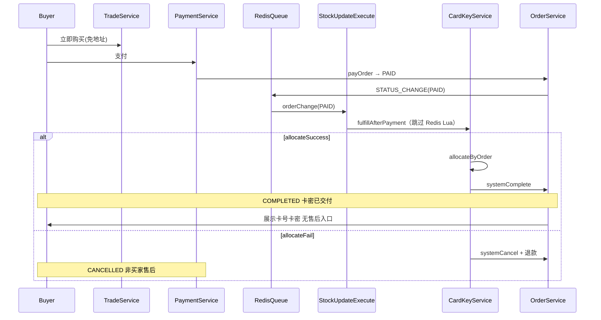
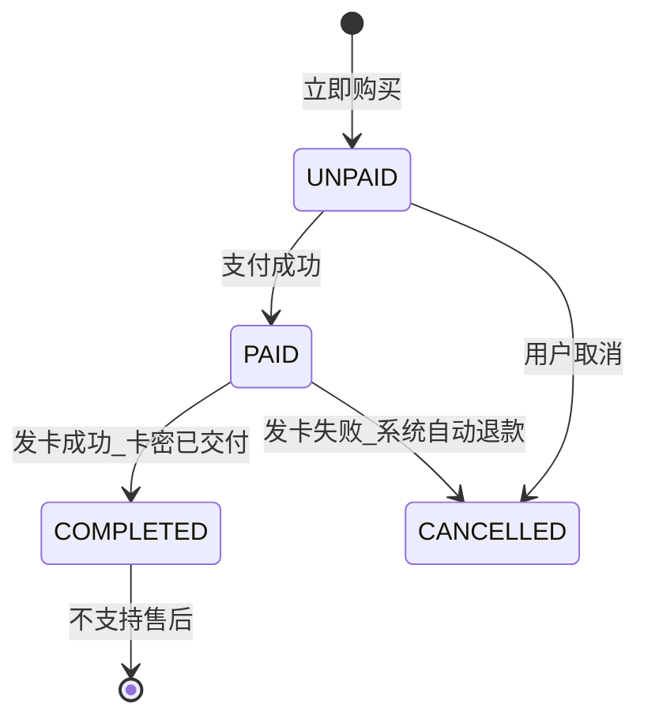

# 卡密商品需求文档（v4）

| 属性 | 内容 |
|------|------|
| 文档版本 | v4.7 |
| 状态 | 草案 |
| 创建日期 | 2026-07-24 |
| 边界决策 | [card-key-goods-decisions.md](./card-key-goods-decisions.md)（2026-07-27 拍板；O-10/O-11 2026-07-29；**O-12 2026-07-30**） |
| 上一版本 | [v3.0](./card-key-goods-v3.md) |
| 适用范围 | lilishop 商家端 / 买家端 / 平台端 |
| 关联模块 | `goods`、`order`、`payment` |
| 商品类型方案 | **方案 A：复用 `E_COUPON`（电子卡券）** |

## 目录

- [1. 文档说明](#1-文档说明)
  - [1.1 目的](#11-目的)
  - [1.2 v4 相对 v3 的主要变更](#12-v4-相对-v3-的主要变更)
  - [1.2b v4.3 相对 v4.2 变更](#12b-v43-相对-v42-变更2026-07-27)
  - [1.2c v4.4 相对 v4.3 变更](#12c-v44-相对-v43-变更2026-07-29)
  - [1.2d v4.5 相对 v4.4 变更](#12d-v45-相对-v44-变更2026-07-29)
  - [1.2e v4.6 相对 v4.5 变更](#12e-v46-相对-v45-变更2026-07-30)
  - [1.2f v4.7 相对 v4.6 变更](#12f-v47-相对-v46-变更2026-07-30)
  - [1.3 v3 及更早版本变更摘要](#13-v3-及更早版本变更摘要)
  - [1.4 不在本期范围](#14-不在本期范围)
  - [1.5 术语](#15-术语)
- [2. 背景与目标](#2-背景与目标)
  - [2.1 业务背景](#21-业务背景)
  - [2.2 产品目标](#22-产品目标)
  - [2.3 卡密已交付（核心业务规则）](#23-卡密已交付核心业务规则)
  - [2.4 成功指标](#24-成功指标)
- [3. 现状分析（AS-IS）](#3-现状分析as-is)
  - [3.1 商品与订单](#31-商品与订单)
  - [3.2 现有售后逻辑（需改造）](#32-现有售后逻辑需改造)
  - [3.3 异步消息（Redis 队列）](#33-异步消息redis-队列)
- [4. 方案选定](#4-方案选定)
- [5. 角色与功能需求](#5-角色与功能需求)
  - [5.1 商家端](#51-商家端store)
  - [5.2 买家端](#52-买家端buyer)
  - [5.3 平台端](#53-平台端manager)
- [6. 核心业务流程](#6-核心业务流程)
  - [6.1 主流程（含交付完成）](#61-主流程含交付完成)
  - [6.2 状态机](#62-状态机)
  - [6.3 与虚拟核销 / 实物订单差异](#63-与虚拟核销--实物订单差异)
  - [6.4 库存同步](#64-库存同步)
  - [6.5 支付后履约路由](#65-支付后履约路由o-10--v44)
  - [6.6 下单阶段归一化](#66-下单阶段归一化o-11--v45)
  - [6.7 AC-02 加固与部署](#67-ac-02-加固与部署o-12--ec-27ec-28)
- [7. 数据模型](#7-数据模型)
  - [7.1 表 `li_card_key`](#71-表-li_card_key)
    - [字段清单](#711-字段清单)
    - [索引设计](#712-索引设计)
    - [建表 DDL](#713-建表-ddl)
    - [库存统计](#714-库存统计)
  - [7.2 状态枚举](#72-状态枚举)
  - [7.3 扩展 VO 字段](#73-扩展-vo-字段)
- [8. 接口清单](#8-接口清单)
  - [8.1 商家端](#81-商家端)
  - [8.2 买家端](#82-买家端)
  - [8.3 内部服务](#83-内部服务)
- [9. 非功能与风控需求](#9-非功能与风控需求)
  - [9.1 并发与幂等](#91-并发与幂等)
  - [9.2 安全](#92-安全)
  - [9.3 异常处理](#93-异常处理)
  - [9.4 售后策略（v3 核心）](#94-售后策略v3-核心)
  - [9.5 性能](#95-性能)
- [10. 边界场景](#10-边界场景)
- [11. 分期实施](#11-分期实施)
- [12. 验收标准](#12-验收标准)
- [13. 测试场景](#13-测试场景)
- [附录 A：可复用代码](#附录-a可复用代码)
- [附录 B：需改动文件](#附录-b需改动文件)
- [附录 C：Excel 导入模板](#附录-cexcel-导入模板)
- [附录 D：需求追溯](#附录-d需求追溯)

---

## 1. 文档说明

### 1.1 目的

本文档定义 lilishop 平台「卡密商品（电子卡券）」功能的标准化需求（第四版），用于产品评审、研发拆任务与测试验收。卡密商品本质是**虚拟商品 + 自动发卡**：商家维护卡密池，买家支付成功后系统自动分配卡号/卡密，订单完成即视为**卡密已交付**。

### 1.2 v4 相对 v3 的主要变更

| 序号 | 变更项 | v3 | v4.2 |
|------|--------|----|------|
| 1 | `expire_time` 字段 | 可选；空表示不过期 | **无**；卡密不设过期时间 |
| 2 | 单条新增 / Excel 导入 | 卡号、卡密、可选过期时间 | 仅 **卡号、卡密** |
| 3 | 建表 DDL | `expire_time` 允许 NULL | **无** `expire_time` 列 |
| 4 | 可售库存 / 发卡 | 可选过滤过期 UNUSED | 仅 `status = UNUSED`，**无时间过滤** |
| 5 | 边界决策 | 分散/待确认 | 见 [card-key-goods-decisions.md](./card-key-goods-decisions.md)（2026-07-26 拍板） |
| 6 | v4.2 原型对齐（2026-07-27） | 列表/订单含过期时间 | **移除** `expire_time`；导入仅卡号+卡密；UI 无失效时间列 |

### 1.2a v4.2 相对 v4.1 变更（2026-07-27）

| 变更项 | 说明 |
|--------|------|
| 数据模型 | `li_card_key` **无** `expire_time` 列 |
| 导入/新增 | 仅 `cardNo`、`cardSecret` |
| 卡池列表 | 无「失效时间」筛选与列；仅卡号/卡密/状态/导入时间 |
| 订单卡密展示 | 无「过期时间」列；无 `expired` 字段 |
| 可售/分配 | `UNUSED` + 未删即可，**无**时间条件 |

### 1.2b v4.3 相对 v4.2 变更（2026-07-27）

| 变更项 | 说明 |
|--------|------|
| 结算 O-05 | 一单**仅 1 个** E_COUPON SKU（同 SKU `num > 1` 仍允许多张卡） |
| 结算 O-06 | 与 `VIRTUAL_GOODS`、实物等 **goodsType 混单拦截**（EC-15 扩展） |
| 促销 M-01 | **不开放**满减/优惠券/拼团/满赠等；**不可作为满额活动赠品**；仅立即购买 |
| 退款 O-08 | 系统退款前已分配卡密统一 **VOIDED**，不回收到 UNUSED |
| 商家 S-09 | 商家查卡密：**方案 A**，扩展商家订单详情；不实现 API-S-06 |
| 商家 S-08 | 卡池导出：**同步文件流**，不采用异步 `downloadUrl` |
| 商家 S-06 | 审核拒绝禁管卡池；待审核可备货；SKU 软删时 UNUSED/VOIDED 软删、ALLOCATED 保留 |
| 商家 S-07 | 关店：全店 UNUSED/VOIDED 软删；禁新单；PAID 继续发卡；历史可查卡密 |

### 1.2c v4.4 相对 v4.3 变更（2026-07-29）

| 变更项 | 说明 |
|--------|------|
| 支付后履约 O-10 | **三层路由防护**：`StockUpdateExecute` 对 `E_COUPON` 显式调用 `fulfillAfterPayment`；禁止误入 `virtualOrderConfirm` → `TAKE` |
| 内部服务 SVC-07 | 新增 `CardKeyService.fulfillAfterPayment(orderSn)`：购买型发卡 + `COMPLETED`；失败系统退款 |
| 边界 EC-24 | E_COUPON 支付后**不得**进入 `TAKE`（待核验）；终态为 `COMPLETED` 或发卡失败 `CANCELLED` |
| 实现文件 | `StockUpdateExecute`、`CardKeyServiceImpl`、`OrderServiceImpl.virtualOrderConfirm` 兜底转发 |
| 测试 | `CardKeyServiceImplFulfillTest`、`StockUpdateExecuteRoutingTest` |

### 1.2d v4.5 相对 v4.4 变更（2026-07-29）

| 变更项 | 说明 |
|--------|------|
| 下单归一化 O-11 | `isECouponOnlyTrade` + `normalizeECouponTrade`：免地址、`deliveryMethod=VIRTUAL`、freight=0 |
| 渲染隔离 | `eCouponCheckedRender` / `eCouponTradeRender`：跳过满减/券/礼品卡/运费 |
| 促销 M-01 补强 | `validatePromotionForbidden` 拦截 `payPoint`、满减、`discountPrice`/`couponPrice`/`giftCardPrice` |
| 库存 EC-25 | PAID **跳过** Redis Lua；卡池 `allocateByOrder` 为唯一扣减；`syncSkuStock` 更新镜像 |
| 下单前库存 | 加购/立即购买对 E_COUPON 使用 `countUnusedPoolStock` |
| 边界 EC-26 | 订单落库无 consignee、`deliveryMethod=VIRTUAL` |
| 测试 | `CardKeyServiceImplValidationTest` 扩展；`StockUpdateExecuteRoutingTest` 跳过 Redis |

### 1.2e v4.6 相对 v4.5 变更（2026-07-30）

> 对应实现计划：**E_COUPON AC-02 修复**（不含历史 TAKE 订单批量修复）。

| 变更项 | 说明 |
|--------|------|
| 下单金额 O-12a | `eCouponCheckedRender` / `eCouponTradeRender` 补 `SKU_PROMOTION`（E_COUPON-only **仅** `renderBasePrice`）；`CheckDataRender` 始终刷新 E_COUPON 单价；`validateTradeForECoupon` 拦截 `flowPrice <= 0` → `CARD_KEY_ZERO_PRICE(11051)` |
| 0 元自动支付 O-12b | `OrderStatusHandlerExecute.orderCreate`：E_COUPON-only 且 `flowPrice <= 0` 时**不**自动 `payTrade` |
| 虚拟核销 CAS O-12c | `virtualOrderConfirm`：`TAKE` 写入改为 **CAS**（仅 `orderType=VIRTUAL` 且 `orderStatus=PAID`）；E_COUPON 仍转发 `fulfillAfterPayment` |
| PAID 并发 O-12d | `StockUpdateExecute`：PAID 分支 Redis 锁 `order:paid:handle:{orderSn}`（TTL 120s）；E_COUPON 已 `COMPLETED` 幂等跳过 |
| 库存确认加固 O-12e | `afterOrderConfirm`：`VIRTUAL` 且非 `PAID` 时跳过 `virtualOrderConfirm` |
| 边界 EC-27 | E_COUPON 建单 `flow_price` 必须 **> 0**；禁止 0 元误触发自动支付 |
| 边界 EC-28 | **部署约束**：`buyer-api` + `manager-api` 须同批发布；全局仅 **1** 个 manager-api 消费 PAID；旧 jar / 多实例混跑可导致 `TAKE`（见 §6.7） |
| 测试 | `ECouponPriceRenderTest`、`OrderServiceImplVirtualConfirmTest`；扩展 `StockUpdateExecuteRoutingTest`、`CardKeyServiceImplValidationTest` |
| 集成脚本 | [`scripts/ac02-concurrent-wallet-pay.ps1`](../scripts/ac02-concurrent-wallet-pay.ps1)（AC-02 / TS-11） |

### 1.2f v4.7 相对 v4.6 变更（2026-07-30）

| 变更项 | 说明 |
|--------|------|
| 促销 M-01 补强 | **卡密商品不可作为满额活动赠品**；创建/编辑满减活动时 `giftId` 为 E_COUPON SKU → 拒绝 |
| 满赠 AC-16 | 配置层禁止 + 运行时兜底：若历史数据产生满赠 E_COUPON 子单，仍不扣卡池（EC-08） |
| 错误码 | `FULL_DISCOUNT_GIFT_E_COUPON_ERROR(43010)` |
| 实现 | `FullDiscountServiceImpl.checkGiftSku` |
| 测试 | `FullDiscountServiceImplGiftValidationTest` |

### 1.3 v3 及更早版本变更摘要

详见 [v3 §1.2](./card-key-goods-v3.md#12-v3-相对-v2-的主要变更)、[v2 §1.2](./card-key-goods-v2.md#12-v2-相对-v1-的主要变更)、[v1](./card-key-goods.md)。

### 1.4 不在本期范围

| 模块 | 说明 |
|------|------|
| 买家主动售后 | 退货退款、仅退款、换货等**一律不支持** |
| 礼品卡余额 | [`GiftCardCashCredential`](../../framework/src/main/java/cn/lili/modules/promotion/entity/dos/GiftCardCashCredential.java) |
| 直播优惠券 | 直播领券逻辑 |
| 核销型虚拟商品 | [`VIRTUAL_GOODS`](../../framework/src/main/java/cn/lili/modules/goods/entity/enums/GoodsTypeEnum.java) |
| 购物车购买 | 不支持 E_COUPON 加入购物车 |
| 营销活动 | 满减、优惠券、拼团、满赠、积分抵扣等**不参与** E_COUPON 购买；**不可作为满额活动赠品**（M-01） |
| 低库存预警 | 不支持 |
| 具体实现 | Java 代码、SQL migration、前端原型 |

### 1.5 术语

| 术语 | 定义 |
|------|------|
| 卡密商品 | `goodsType = E_COUPON` 的 SKU，以卡号/卡密为交付物 |
| 卡池 | 某 SKU 下所有 `UNUSED` 状态卡密 |
| 发卡 | 支付成功后从卡池取卡并绑定订单 |
| 卡密已交付 | 支付成功且发卡成功，买家可在订单详情查看卡号/卡密；**交付完成后不可售后** |
| 立即购买 | `CartTypeEnum.BUY_NOW`，不经过购物车 |
| 系统异常退款 | 仅因**发卡失败**等系统原因触发的自动原路退款，**不属于**买家售后 |

---

## 2. 背景与目标

### 2.1 业务背景

电子卡券（卡密商品）的核心价值是**支付后立即获得可用凭证**。与实物/核销型虚拟商品不同：

- 无需物流、无需商家人工核销
- **一旦支付成功并完成发卡，卡密即交付给买家**，具有不可逆性
- 因此**不支持买家发起售后**（退货退款、仅退款均不支持）

现有 lilishop 需补齐：`E_COUPON` 上架、卡密池、支付后自动发卡、订单详情展示卡密，以及**售后入口屏蔽**。

### 2.2 产品目标

1. **商家**：发布 `E_COUPON` 商品、导入/作废卡密，卡池可用数 = 可售库存
2. **买家**：立即购买、免地址；支付成功后订单详情**直接展示**卡号/卡密并可复制
3. **平台**：并发安全、支付幂等、卡密加密存储；**卡密交付后不支持售后**

### 2.3 卡密已交付（核心业务规则）

**适用场景**：电子卡券（卡密商品）下单并支付后，系统发卡成功的订单。

| 阶段 | 订单状态 | 卡密状态 | 买家侧 |
|------|----------|----------|--------|
| 下单未支付 | `UNPAID` | 未占用卡池 | 不可见卡密 |
| 支付成功、发卡中 | `PAID`（短暂） | 分配中 | 不可见或 loading |
| **支付成功、发卡成功** | **`COMPLETED`** | **`ALLOCATED`** | **可见卡号/卡密，视为已交付** |
| 支付成功、发卡失败 | 自动退款 → `CANCELLED` | 已分配 → **VOIDED**（O-08） | 无卡密；**非买家售后，为系统异常处理** |

**v3 明确规定**：

> 当订单为 `orderType = E_COUPON` 且状态为 `COMPLETED`（即支付成功且卡密已分配）时，**卡密已交付**，订单为**最终态**：不支持退货退款、不支持仅退款，**不展示任何售后入口**。

### 2.4 成功指标

- 支付成功 → 发卡成功率 ≥ 99.9%（卡池充足前提下）
- 并发同 SKU 零重复发卡
- 卡密明文不出现在应用日志
- E_COUPON 已完成订单售后入口展示率 = 0%

---

## 3. 现状分析（AS-IS）

### 3.1 商品与订单

[`GoodsTypeEnum`](../../framework/src/main/java/cn/lili/modules/goods/entity/enums/GoodsTypeEnum.java) 含 `E_COUPON`，但 [`GoodsServiceImpl.checkGoods()`](../../framework/src/main/java/cn/lili/modules/goods/serviceimpl/GoodsServiceImpl.java) 拦截上架。

[`OrderTypeEnum.E_COUPON`](../../framework/src/main/java/cn/lili/modules/order/order/entity/enums/OrderTypeEnum.java) 目前主要用于满赠子订单；买家购买链路与卡密展示尚未实现。

### 3.2 现有售后逻辑（需改造）

[`AfterSaleServiceImpl`](../../framework/src/main/java/cn/lili/modules/aftersale/serviceimpl/AfterSaleServiceImpl.java) 对 `VIRTUAL` 订单允许「仅退款」。**E_COUPON 卡密订单需完全排除**：

- 买家端：订单详情、订单列表**不展示**「申请售后」「仅退款」「退货退款」等入口
- 接口层：`applyAfterSaleInfo` / `saveAfterSale` 对 `orderType = E_COUPON` **拒绝受理**
- 商家端：对应 E_COUPON 订单**不展示**售后处理入口（若原列表有聚合，需过滤）

### 3.3 异步消息（Redis 队列）

```
OrderServiceImpl.sendUpdateStatusMessage()
  → TransactionCommitSendMQEvent
  → Redis 队列（LiliMessageTemplate / RedisQueueConsumer）
  → MessageDispatcher.dispatch()
  → OrderMessageListener.orderStatusEvent()
  → StockUpdateExecute（PAID）
       ├─ orderType = E_COUPON → CardKeyService.fulfillAfterPayment（**跳过 Redis Lua**）
       └─ 其他类型 → Redis 扣 SKU 库存 → OrderServiceImpl.afterOrderConfirm
  → VerificationOrderExecute 等（E_COUPON 跳过 TAKE 核销码逻辑）
```

**部署注意（O-10 / O-12 / EC-28）**：

| 项 | 要求 |
|----|------|
| 发布模块 | **buyer-api + manager-api 同时**发布（framework 改动需打进两侧 jar） |
| 消息消费 | `lili.message.consumer.enabled=true` **仅 manager-api** 开启 |
| 消费者数量 | 同一 Redis 上 **仅 1 个** manager-api 实例消费 PAID（含 Docker 与 IDE 勿混跑） |
| 滚动发布 | 避免新旧 jar **并存**消费同一 PAID 消息 |
| 冒烟 | 先发 1 笔 BUY_NOW：确认 `flow_price > 0`、钱包支付后 `COMPLETED` + 卡密，再跑 AC-02 |

**日志关键字（新 jar）**：`电子卡券支付后履约开始/完成`；**不应**对 E_COUPON 出现 `库存扣减成功` 后进入 `TAKE`。

---

## 4. 方案选定

沿用 v2：**复用 `E_COUPON`**，不新增 `CARD_KEY`。详见 [v2 §4](./card-key-goods-v2.md#4-方案选定)。

---

## 5. 角色与功能需求

### 5.1 商家端（`/store/...`）

#### FR-S-01 发布卡密商品

| 项 | 要求 |
|----|------|
| 商品类型 | `E_COUPON`（电子卡券） |
| 运费模板 | `templateId = 0` |
| SKU 库存 | 只读展示「卡池可用数」 |
| 商品信息 | 沿用现有发布、审核流程 |

#### FR-S-02 卡密导入

| 项 | 要求 |
|----|------|
| 批量导入 | Excel，单次 ≤ 10,000 行 |
| 单条新增 | 卡号、卡密 |
| 校验 | SKU 内 `cardNo` 唯一；`cardNo` / `cardSecret` trim 后非空；失败返回行号 |

#### FR-S-03 卡池管理

| 项 | 要求 |
|----|------|
| 列表 | 分页；状态 `UNUSED` / `ALLOCATED` / `VOIDED`；支持按**导入时间**（`create_time`）区间筛选 |
| 列表展示 | **卡号 + 卡密（明文）** + 状态 + 导入时间；与原型 P-04 一致 |
| 作废 | 仅 `UNUSED` 可作废 |
| 统计 | 各状态数量 |
| 低库存预警 | **不支持** |
| 导出 | 支持 Excel 导出（含明文卡密）；见 FR-S-06 |

#### FR-S-04 订单卡密查看

| 项 | 要求 |
|----|------|
| 场景 | 已发卡（`COMPLETED`）订单 |
| 入口 | **仅**商家订单详情 `GET /store/order/order/{orderSn}` 的 `orderItems[].cardKeys`（S-09）；**不实现**独立 API-S-06 |
| 展示 | 明文卡号、卡密 |
| 权限 | 本店 `storeId` 隔离即可，**不做管理员权限判断** |

#### FR-S-05 订单售后（v3 新增）

| 项 | 要求 |
|----|------|
| 售后入口 | **不展示**（退货退款、仅退款均无入口） |
| 售后处理 | 商家端不对 E_COUPON 购买订单提供售后审核/处理 |

#### FR-S-06 卡池导出（2026-07-26 拍板）

| 项 | 要求 |
|----|------|
| 能力 | 按 SKU/状态/时间筛选导出卡池为 Excel |
| 方式 | **同步文件流**（S-08）；`GET` 直接下载，单次 ≤ 10,000 行 |
| 字段 | 含 `cardNo`、`cardSecret`（明文）、`status`、`createTime` 等 |
| 权限 | 仅本店商家；**平台管理员不提供**代导出 |
| 接口 | API-S-07 |

#### FR-S-07 商品下架与卡池（2026-07-26 拍板）

| 项 | 要求 |
|----|------|
| 下架 | 商品下架后 **UNUSED 卡池保留**，不自动作废 |
| 再上架 | 可售库存随 `poolStock` 恢复销售 |

#### FR-S-08 审核与删除（2026-07-27 拍板 / S-06）

| 项 | 要求 |
|----|------|
| 审核拒绝 | `auth_flag = REFUSE` 时 **禁止**卡池管理（API-S-01~S-05、S-07）；卡密行**保留** |
| 待审核 | `auth_flag = TOBEAUDITED` 时 **允许**导入/维护卡池（备货） |
| SKU 软删除 | 商品/SKU `delete_flag = 1` 时：该 SKU 下 `UNUSED`、`VOIDED` → `li_card_key.delete_flag = 1`；**`ALLOCATED` 不删** |
| 库存同步 | SKU 软删除后 `poolStock = 0`；**禁止**物理 `DELETE` `li_card_key` |
| 与 S-05 | **下架**保留池；**删除**清未售/作废池（软删），已售保留 |

#### FR-S-09 店铺关店（2026-07-27 拍板 / S-07 方案 A）

| 项 | 要求 |
|----|------|
| 卡池 | 关店触发全店 E_COUPON：`UNUSED`/`VOIDED` → `delete_flag = 1`（SVC-06）；**禁止**卡池管理 API |
| 新订单 | **禁止**该店新 E_COUPON 下单/支付 |
| UNPAID | 允许取消；**不可再支付** |
| PAID 未发卡 | **继续** `allocateByOrder`；失败走 O-01/O-08 系统退款 |
| 历史订单 | `COMPLETED`/`ALLOCATED` **保留**；买家/商家订单详情仍可查卡密 |

### 5.2 买家端（`/buyer/...`）

#### FR-B-01 购买

| 项 | 要求 |
|----|------|
| 购买方式 | **仅立即购买**；**不参与**满减、优惠券、拼团、满赠等营销活动；**不可作为满额活动赠品**（M-01） |
| 收货地址 | 不需要 |
| 加购 | **禁止**加入购物车 |
| 单独结算 | **卡密单独结算**：同一笔订单/交易不得与**实物、`VIRTUAL_GOODS` 或其他 `goodsType`** 混单（见 EC-15） |
| 单 SKU | **一单仅 1 个 E_COUPON SKU**；同一 SKU 购买 N 件 → N 张卡（见 EC-19） |
| 库存 | 下单前 `poolStock ≥ 购买数量`，不足则**拦截下单**（见 EC-14） |

#### FR-B-02 履约与订单状态

| 项 | 要求 |
|----|------|
| 适用范围 | **仅购买型** E_COUPON：`orderPromotionType ≠ GIFT` 且无 `parentOrderSn`（满赠子单 P0 不走卡池，见 EC-08） |
| 支付成功 | 自动发卡 → `COMPLETED` |
| 卡密已交付 | 发卡成功即交付；订单详情可查看卡号/卡密 |
| 不走核销 | 无 `TAKE`、无 8 位核销码 |
| 原子性 | 任一 orderItem 取卡失败 → **整单失败** + 系统退款（见 EC-16） |
| 通知 | **不发**站内信/短信（发卡成功不扩展消息模板） |

#### FR-B-03 查看卡密

| 项 | 要求 |
|----|------|
| 入口 | **仅**订单详情 `GET /buyer/order/order/{orderSn}` 的 `orderItems[].cardKeys`；**不实现**独立按订单项查卡密接口 |
| 时机 | **仅**支付成功且发卡成功后（`COMPLETED`） |
| 展示 | 直接明文展示卡号、卡密 |
| 多件 | 购买 N 件 → N 组卡号+卡密 |
| 复制 | 支持复制 |

#### FR-B-04 售后（v3 新增）

| 项 | 要求 |
|----|------|
| 售后类型 | **不支持**退货退款、**不支持**仅退款 |
| 入口展示 | 订单列表、订单详情、订单项**均不展示**售后相关按钮/链接 |
| 接口 | 售后申请接口对 E_COUPON 订单返回业务错误 |

**说明**：发卡失败导致的**系统自动原路退款**不属于买家售后，无需展示售后入口，由系统静默处理并通知买家支付失败/订单关闭。

### 5.3 平台端（`/manager/...`）

沿用商品审核；P2 可选异常发卡监控。**不涉及** E_COUPON 买家售后仲裁（因不支持售后）。

**卡密权限（2026-07-26 拍板）**：平台管理员**不得**代商家查询卡池明文、**不得**代发作废卡密；不新增 manager 卡密 HTTP 接口。

---

## 6. 核心业务流程

### 6.1 主流程（含交付完成）



**与虚拟核销差异**：`VIRTUAL` 订单在 `afterOrderConfirm` 中走 `virtualOrderConfirm` → **`TAKE`（待核验）**；`E_COUPON` **不得**进入该路径（见 §6.5、EC-24）。

### 6.2 状态机



**`COMPLETED` 为终态**：无售后、无退货、无仅退款。

### 6.3 与虚拟核销 / 实物订单差异

| 环节 | 实物 | VIRTUAL_GOODS | E_COUPON（卡密） |
|------|------|---------------|------------------|
| 支付后订单状态 | `UNDELIVERED` | **`TAKE`（待核验）** | **`COMPLETED`**（发卡成功） |
| 支付后交付 | 物流 | 核销码 | **卡号+卡密** |
| 完成条件 | 确认收货 | 商家核销 | **自动发卡（fulfillAfterPayment）** |
| 买家售后 | 支持 | 仅退款 | **不支持** |
| 售后入口 | 有 | 有 | **无** |

### 6.4 库存同步

同 v2：导入 +N、作废 -N、发卡 `ALLOCATED`；**买家售后作废路径删除**（因无买家退款）。系统异常退款若已分配卡密，卡密标记 `VOIDED` 且不回收。

### 6.5 支付后履约路由（O-10 / v4.4）

E_COUPON 支付成功后**不得**沿用虚拟核销的 `virtualOrderConfirm` → `TAKE` 路径；须通过 **`fulfillAfterPayment`** 完成发卡并进入 `COMPLETED`。

**三层防护**（任一命中即可正确履约）：

| 层级 | 位置 | 行为 |
|------|------|------|
| L1 | `StockUpdateExecute.orderChange(PAID)` | 若 `orderType = E_COUPON` → **直接** `fulfillAfterPayment`，**跳过** Redis Lua / `afterOrderConfirm`；PAID 消息加 Redis 锁 + 已 `COMPLETED` 幂等跳过（O-12d） |
| L2 | `OrderServiceImpl.afterOrderConfirm` | 若 `orderType = E_COUPON` → 委托 `fulfillAfterPayment`；`VIRTUAL` 非 `PAID` 跳过（O-12e） |
| L3 | `OrderServiceImpl.virtualOrderConfirm` | 若 `orderType = E_COUPON` → **转发** `fulfillAfterPayment`；`VIRTUAL+PAID` 才 CAS 写 `TAKE`（O-12c） |

**`fulfillAfterPayment` 概要**（SVC-07）：

1. 幂等：已 `COMPLETED` 则跳过。
2. **购买型**（非满赠子单）：`allocateByOrder` → 成功则 `systemComplete`；失败则 `voidOnSystemFailure` + `syncSkuStock` + `systemCancel`（系统退款）。
3. **非购买型**（满赠子单等）：直接 `systemComplete`，不扣卡池（EC-08）。

**运维**：全量重启 `manager-api`；仅 manager-api 开启 `lili.message.consumer.enabled=true`；滚动发布时避免新旧版本并存消费同一 PAID 消息。日志关键字：`电子卡券支付后履约开始/完成`。

### 6.6 下单阶段归一化（O-11 / v4.5）

E_COUPON 立即购买须**免地址、虚拟发货、无促销渲染**：

| 层级 | 位置 | 行为 |
|------|------|------|
| 识别 | `CardKeyService.isECouponOnlyTrade` | 已选 SKU 均为 `goodsType=E_COUPON` |
| 归一化 | `normalizeECouponTrade` | 清 `memberAddress`；`deliveryMethod=VIRTUAL`；清券/礼品卡选择 |
| 渲染 | `TradeBuilder` → `eCouponTradeRender` | 不跑 FULL_DISCOUNT/COUPON/GIFT_CARD/SKU_FREIGHT；**含** `SKU_PROMOTION`（E_COUPON-only 仅 basePrice，AC-19） |
| 校验 | `validatePromotionForbidden` + `validateTradeForECoupon` | 拦截积分/满减/优惠金额；**`flowPrice <= 0` → `CARD_KEY_ZERO_PRICE`**（O-12a） |
| 落库 | `Order` 构造 | E_COUPON 强制 `VIRTUAL`、不写 consignee、freight=0 |
| 扣库存 | `StockUpdateExecute` PAID | **不** Redis Lua；直接 `fulfillAfterPayment` |

### 6.7 AC-02 加固与部署（O-12 / EC-27~EC-28）

**背景（2026-07-30 实测）**：v4.5 已实现 O-10/O-11，但 AC-02 曾出现：

| 现象 | 根因 |
|------|------|
| 全部 `flow_price = 0`、建单即自动支付 | `eCouponTradeRender` 缺 `SKU_PROMOTION`，`CartPriceRender` 清空后未回填 `goodsPrice` |
| 部分 `COMPLETED`、部分 `TAKE` | 新 `fulfillAfterPayment` 与旧/并行 `virtualOrderConfirm → TAKE` 竞态；**旧 jar 或多 manager-api 消费者** |

**O-12 修复要点**（已实现；**不修复历史 TAKE 订单**）：

1. **价格**：补 `SKU_PROMOTION` basePrice；`CheckDataRender` 刷新 E_COUPON 单价；`CARD_KEY_ZERO_PRICE`；禁止 E_COUPON 0 元自动 `payTrade`。
2. **路由**：`virtualOrderConfirm` CAS；PAID Redis 锁；`afterOrderConfirm` 加固。
3. **验收**：新单 `flow_price > 0`；支付后 `COMPLETED` + 卡密；AC-02 脚本 10 并发无重复卡号。

**部署 checklist**：

- [ ] `mvn -pl buyer-api,manager-api -am clean package` 后**同时**重启两侧
- [ ] 确认仅 **1** 个 manager-api 消费 Redis（`docker ps` / 8887 单进程 / `CLIENT LIST` + 支付时 `MONITOR`）
- [ ] 勿与 Docker 内旧 manager-api **共用同一 Redis** 而不下线旧容器
- [ ] 1 笔冒烟通过后执行 [`scripts/ac02-concurrent-wallet-pay.ps1`](../scripts/ac02-concurrent-wallet-pay.ps1)

**不在范围**：历史误入 `TAKE` 的订单批量修复；不启用 `repairStuckECouponOrderIfNeeded`。

---

## 7. 数据模型

### 7.1 表 `li_card_key`

**表说明**：电子卡券（卡密商品）卡池表。一行记录代表 **一张** 卡号/卡密及其生命周期；可售库存 = 该 SKU 下 `status = UNUSED` 且 `delete_flag = 0` 的行数。

**命名规范**：遵循 lilishop `li_*` 表名；实体继承 [`BaseEntity`](../../framework/src/main/java/cn/lili/mybatis/BaseEntity.java)，审计字段由 [`MyMetaObjectHandler`](../../framework/src/main/java/cn/lili/mybatis/mybatisplus/MyMetaObjectHandler.java) 自动填充。

**关联关系**：

| 关联表 | 字段 | 说明 |
|--------|------|------|
| `li_goods_sku` | `sku_id` | 卡密所属 SKU（必填） |
| `li_goods` | `goods_id` | 冗余 SPU，便于按商品查询 |
| `li_store` | `store_id` | 店铺隔离 |
| `li_order` | `order_sn` | 发卡成功后绑定 |
| `li_order_item` | `order_item_sn` | 按订单项分配（买 N 件 N 张卡） |
| `li_member` | `member_id` | 买家 ID（发卡时写入） |

#### 7.1.1 字段清单

| 字段 | 类型 | 必填 | 默认值 | 说明 |
|------|------|------|--------|------|
| id | varchar(32) | 是 | — | 主键，Snowflake |
| create_by | varchar(64) | 否 | SYSTEM | 创建者（BaseEntity） |
| create_time | datetime | 是 | 当前时间 | 创建时间（BaseEntity） |
| update_by | varchar(64) | 否 | — | 更新者（BaseEntity） |
| update_time | datetime | 否 | — | 更新时间（BaseEntity） |
| delete_flag | bit(1) | 是 | 0 | 软删：0 未删 / 1 已删（BaseEntity） |
| sku_id | varchar(32) | 是 | — | 关联 `li_goods_sku.id` |
| goods_id | varchar(32) | 是 | — | 关联 `li_goods.id`（冗余） |
| store_id | varchar(32) | 是 | — | 店铺 ID |
| card_no | varchar(128) | 是 | — | 卡号；**同 SKU 内唯一** |
| card_secret | varchar(512) | 是 | — | 卡密；AES 加密后的密文 |
| status | varchar(32) | 是 | UNUSED | 见 §7.2：`UNUSED` / `ALLOCATED` / `VOIDED` |
| order_sn | varchar(64) | 否 | NULL | 主订单编号；未售为空 |
| order_item_sn | varchar(64) | 否 | NULL | 订单项编号；未售为空 |
| member_id | varchar(32) | 否 | NULL | 买家会员 ID；发卡时写入 |
| allocated_time | datetime | 否 | NULL | 发卡时间（`ALLOCATED` 时写入） |

**字段约束**：

- `card_no`、`card_secret`：导入时 trim，不允许为空字符串
- `card_secret`：入库前 AES 加密；接口/日志禁止明文落库以外的泄露
- `order_sn` / `order_item_sn` / `member_id` / `allocated_time`：仅 `status = ALLOCATED` 时应有值
- 作废（`VOIDED`）后**不回收**为 `UNUSED`，同一 `card_no` 不可再次导入（依赖唯一索引）

#### 7.1.2 索引设计

| 索引名 | 字段 | 类型 | 用途 |
|--------|------|------|------|
| PRIMARY | id | PRIMARY | 主键 |
| uk_sku_card_no | (sku_id, card_no) | UNIQUE | 同 SKU 卡号唯一；防重复导入 |
| idx_sku_status | (sku_id, status, delete_flag) | INDEX | 卡池列表、可售库存统计 |
| idx_store_sku | (store_id, sku_id) | INDEX | 商家端按店铺 + SKU 查询 |
| idx_order_sn | (order_sn) | INDEX | 按订单查已分配卡密 |
| idx_order_item_sn | (order_item_sn) | INDEX | 按订单项查卡密（买多件） |
| idx_member_id | (member_id) | INDEX | 可选；按买家查历史卡密 |

**并发发卡**：分配时使用（须为**购买型**订单，见 FR-B-02）：

```sql
SELECT ... FROM li_card_key
WHERE sku_id = ?
  AND status = 'UNUSED'
  AND delete_flag = 0
ORDER BY create_time ASC
LIMIT N
FOR UPDATE
```

配合事务；取到数量 `< N` 则整单发卡失败（EC-16）。

#### 7.1.3 建表 DDL

```sql
CREATE TABLE `li_card_key` (
  `id`              varchar(32)   NOT NULL COMMENT '主键',
  `create_by`       varchar(64)   DEFAULT NULL COMMENT '创建者',
  `create_time`     datetime      DEFAULT NULL COMMENT '创建时间',
  `update_by`       varchar(64)   DEFAULT NULL COMMENT '更新者',
  `update_time`     datetime      DEFAULT NULL COMMENT '更新时间',
  `delete_flag`     bit(1)        DEFAULT b'0' COMMENT '删除标志 false/true',
  `sku_id`          varchar(32)   NOT NULL COMMENT 'SKU ID',
  `goods_id`        varchar(32)   NOT NULL COMMENT '商品 SPU ID',
  `store_id`        varchar(32)   NOT NULL COMMENT '店铺 ID',
  `card_no`         varchar(128)  NOT NULL COMMENT '卡号',
  `card_secret`     varchar(512)  NOT NULL COMMENT '卡密(AES密文)',
  `status`          varchar(32)   NOT NULL DEFAULT 'UNUSED' COMMENT 'UNUSED/ALLOCATED/VOIDED',
  `order_sn`        varchar(64)   DEFAULT NULL COMMENT '主订单号',
  `order_item_sn`   varchar(64)   DEFAULT NULL COMMENT '订单项号',
  `member_id`       varchar(32)   DEFAULT NULL COMMENT '买家ID',
  `allocated_time`  datetime      DEFAULT NULL COMMENT '发卡时间',
  PRIMARY KEY (`id`),
  UNIQUE KEY `uk_sku_card_no` (`sku_id`, `card_no`),
  KEY `idx_sku_status` (`sku_id`, `status`, `delete_flag`),
  KEY `idx_store_sku` (`store_id`, `sku_id`),
  KEY `idx_order_sn` (`order_sn`),
  KEY `idx_order_item_sn` (`order_item_sn`),
  KEY `idx_member_id` (`member_id`)
) ENGINE=InnoDB DEFAULT CHARSET=utf8mb4 COMMENT='电子卡券卡密池';
```

**实体类建议**：`cn.lili.modules.goods.entity.dos.CardKey`，`@TableName("li_card_key")`，状态枚举 `CardKeyStatusEnum`。

#### 7.1.4 库存统计

| 规则 | SQL / 说明 |
|------|------------|
| 可售库存 / poolStock | `SELECT COUNT(*) FROM li_card_key WHERE sku_id = ? AND status = 'UNUSED' AND delete_flag = 0` |
| SKU 同步 | 导入 +N、作废 -N、发卡后不回到 UNUSED；同步更新 `li_goods_sku.quantity` |
| 超卖防护 | 发卡前 Redis Lua 扣减 + DB `FOR UPDATE` 取卡，取到数量不足则失败 |

### 7.2 状态枚举

| 值 | 说明 |
|----|------|
| `UNUSED` | 在库可售 |
| `ALLOCATED` | 已售且已交付（绑定 COMPLETED 订单） |
| `VOIDED` | 作废（商家手动作废 UNUSED；或系统异常退款 **O-08**） |

### 7.3 扩展 VO 字段

**订单 / 订单项 VO**：

| 字段 | 类型 | 说明 |
|------|------|------|
| cardKeyDelivered | boolean | 是否已发卡（`COMPLETED` 且有关联卡密） |
| cardKeys | List\<CardKeyVO\> | 明文卡号、卡密列表 |

**CardKeyVO**：

| 字段 | 类型 | 说明 |
|------|------|------|
| cardNo | string | 卡号 |
| cardSecret | string | 卡密（明文；**商家端**卡池列表、订单卡密、单条新增响应返回；买家端同字段规则见 FR-B-03） |
| allocatedTime | datetime | 发卡时间 |

**CardKeyPoolVO（商家卡池列表项，API-S-03）**：

| 字段 | 类型 | 说明 |
|------|------|------|
| id | string | 卡密记录 ID |
| skuId / goodsId | string | SKU / 商品 ID |
| cardNo | string | 卡号 |
| cardSecret | string | 卡密明文（列表直接展示，见 FR-S-03） |
| status | string | UNUSED / ALLOCATED / VOIDED |
| createTime | datetime | 导入时间 |
| allocatedTime | datetime | 发卡时间（已售时有值） |
| orderSn / orderItemSn | string | 已售时绑定订单 |

**AllowOperation / 订单操作权限（买家端）**：

| 字段 | E_COUPON 订单要求 |
|------|-------------------|
| cancel | 仅 `UNPAID` 可为 true |
| pay | 仅 `UNPAID` 可为 true |
| **rog / refund / afterSale 等售后相关** | **恒为 false，且不返回前端展示字段** |

---

## 8. 接口清单

> **接口详情**（请求/响应、错误码、示例）：见 [card-key-goods-api.md](./card-key-goods-api.md)

### 8.1 商家端

导入、列表、作废、统计、**卡池导出**（API-S-01 ~ S-05、S-07）。

| 编号 | 方法 | 路径 | 说明 |
|------|------|------|------|
| — | GET | `/store/order/order/{orderSn}` | 商家订单详情扩展 `orderItems[].cardKeys`（**查卡密唯一入口**，S-09）；见 API §6.2 |

> **不实现** `GET /store/order/card-key/{orderSn}`（原 API-S-06）。

### 8.2 买家端

| 编号 | 方法 | 路径 | 说明 |
|------|------|------|------|
| API-B-01 | GET | `/buyer/order/order/{orderSn}` | 详情含 `orderItems[].cardKeys`；**不含售后操作项**；**买家查卡密唯一入口** |

> **不实现** `GET /buyer/order/card-key/{orderItemSn}`（原可选 API-B-02）。

**需屏蔽/拒绝的接口（E_COUPON 订单）**：

| 接口 | 行为 |
|------|------|
| `GET /buyer/order/afterSale/applyAfterSaleInfo/{orderItemSn}` | 返回错误或空，**前端不应调用** |
| `POST /buyer/order/afterSale/save/{orderItemSn}` | **拒绝受理**，返回明确业务码 |

### 8.3 内部服务

| 编号 | 方法 | 说明 |
|------|------|------|
| SVC-01 | `CardKeyService.allocateByOrder(orderSn)` | 支付后发卡；**仅购买型** E_COUPON；整单原子 |
| SVC-02 | `CardKeyService.syncSkuStock(skuId)` | 库存同步 |
| SVC-03 | `CardKeyService.voidOnSystemFailure(orderSn)` | **仅**系统异常（发卡失败/自动退款）时作废，非买家售后 |
| SVC-04 | `CardKeyService.importBatch(...)` | 导入 |
| SVC-05 | `CardKeyService.softDeletePoolOnSkuRemove(skuId)` | SPU/SKU 软删除（S-06）：`UNUSED`/`VOIDED` → `delete_flag=1`；`ALLOCATED` 保留；`syncSkuStock` |
| SVC-06 | `CardKeyService.softDeletePoolOnStoreClose(storeId)` | 店铺关店（S-07）：全店 E_COUPON SKU 批量软删 UNUSED/VOIDED；各 SKU `syncSkuStock` |
| SVC-07 | `CardKeyService.fulfillAfterPayment(orderSn)` | 支付后履约（O-10）：购买型发卡 + `COMPLETED`；失败系统退款；`virtualOrderConfirm` 兜底转发 |

---

## 9. 非功能与风控需求

### 9.1 并发与幂等

同 v2（NFR-01 ~ NFR-04）。

### 9.2 安全

同 v2（NFR-05 ~ NFR-07）：库内加密、接口明文、日志脱敏。

### 9.3 异常处理

| 编号 | 场景 | 策略 |
|------|------|------|
| NFR-08 | 支付成功卡池不足 | **系统自动原路退款** + 通知；**非买家售后** |
| NFR-09 | 发卡事务失败 | 已分配卡 **VOIDED** + 系统退款（O-08） |
| NFR-10 | 导入部分失败 | 成功行入库，失败行返回明细 |

### 9.4 售后策略（v3 核心）

| 编号 | 要求 |
|------|------|
| NFR-11 | **`orderType = E_COUPON` 的购买订单：不支持任何买家售后**（退货退款 ❌、仅退款 ❌） |
| NFR-12 | 买家端、商家端 **UI 不展示** 售后入口 |
| NFR-13 | 售后 API 对 E_COUPON 订单 **拒绝创建** 售后单 |
| NFR-14 | **`COMPLETED` 且卡密已交付**：订单终态，不可撤销 |
| NFR-15 | 仅允许**系统异常自动退款**（发卡失败），不走售后模块 |

### 9.5 性能

同 v2（NFR-16 ~ NFR-17）。

---

## 10. 边界场景

| 编号 | 场景 | 预期行为 |
|------|------|----------|
| EC-01 | 重复支付 notify | 只发一组卡 |
| EC-02 | 购买 N 件 | N 组卡密，支付完成后可见 |
| EC-03 | COMPLETED 后买家点售后 | **无入口**；若直调 API 则拒绝 |
| EC-04 | 商家对 E_COUPON 订单发起售后 | **无入口** |
| EC-05 | 加购物车 | 拦截 |
| EC-06 | 发卡失败 | 已分配卡 → **`VOIDED`**（O-08）；系统自动退款，订单关闭，无卡密，**无售后单** |
| EC-07 | 未支付取消 | 不涉及卡池 |
| EC-08 | 满赠 E_COUPON | **配置层**：满额活动赠品 SKU **不可**为 E_COUPON（`FULL_DISCOUNT_GIFT_E_COUPON_ERROR`）；**运行时兜底**：若历史数据产生满赠子单（`orderPromotionType=GIFT` 或存在 `parentOrderSn`），**不走进卡池** |
| EC-09 | 平台管理员 | **不开放**买家售后代操作；**不开放**代查/代作废卡密（见 FR-S-04、§5.3） |
| EC-10 | 跨店访问 | 403 / 无数据 |
| EC-14 | 卡池不足 | **下单前**：`poolStock` 不足 → 拦截下单；**支付后**：取卡仍不足 → 系统 auto 退款（两道防线） |
| EC-15 | E_COUPON 与实物 / `VIRTUAL_GOODS` / 其他类型混单 | **拦截**；提示「电子卡券请单独购买」 |
| EC-16 | 多 orderItem / 多 SKU 部分取卡成功 | **整单失败**；已取卡 **`VOIDED`**（O-08）；整单系统退款 |
| EC-17 | 商品下架 | **UNUSED 卡池保留**；不自动作废；再上架可续售 |
| EC-21 | 商品**审核拒绝**（`REFUSE`） | **禁止**卡池管理 API；数据保留；改审通过后恢复 |
| EC-22 | SPU/SKU **软删除** | `UNUSED`/`VOIDED` → `delete_flag = 1`；**`ALLOCATED` 保留**；`poolStock = 0` |
| EC-23 | **店铺关店**（S-07） | 全店 E_COUPON 未售/作废池软删；禁管卡池、禁新单；UNPAID 不可支付；PAID 继续发卡；历史可查卡密 |
| EC-19 | 一单含 **多个 E_COUPON SKU** | **拦截**；提示「每次仅可购买一种电子卡券」 |
| EC-20 | E_COUPON 参与满减 / 优惠券 / 拼团 / 满赠等 | **拦截**或不叠加；创建交易链路拒绝促销参数；满额活动**不可选** E_COUPON 赠品（M-01） |
| EC-24 | E_COUPON 支付后误入虚拟核销链 | **不得**进入 `TAKE`（待核验）；须 `fulfillAfterPayment` → `COMPLETED` 或发卡失败 `CANCELLED`（O-10） |
| EC-25 | E_COUPON PAID 库存 | **跳过** Redis Lua；卡池分配 + `syncSkuStock` 为权威路径 |
| EC-26 | E_COUPON 下单落库 | `deliveryMethod=VIRTUAL`；**无** consignee；freight=0（O-11） |
| EC-27 | E_COUPON 建单金额为 0 | `flowPrice <= 0` → 创建交易失败 `CARD_KEY_ZERO_PRICE`；**不**走 0 元自动支付（O-12a/b） |
| EC-28 | 多消费者 / 旧 jar 混跑 | 同一 Redis 上多个 manager-api 或新旧 jar 并存 → E_COUPON 可能误入 `TAKE`；发布须 buyer+manager 同批、**单消费者**（O-12 / §6.7） |

> 完整决策说明见 [card-key-goods-decisions.md](./card-key-goods-decisions.md)。

---

## 11. 分期实施

### P0

- [ ] `li_card_key` + E_COUPON 上架 + 导入 + 库存同步
- [ ] 仅立即购买 + 免地址 + 禁加购
- [ ] 支付发卡 + `COMPLETED` + 卡密展示
- [ ] **屏蔽 E_COUPON 售后入口 + API 拒绝**
- [ ] 购买型识别 + 满赠子单排除卡池 + 满额活动禁选 E_COUPON 赠品（EC-08 / M-01）
- [ ] 卡密单独结算 + 单 SKU + 禁混 `VIRTUAL_GOODS`（EC-15、EC-19）
- [ ] 促销不开放（EC-20 / M-01）
- [ ] 下单前库存拦截 + 支付后不足退款（EC-14）
- [ ] 发卡整单原子 + 失败卡 VOIDED（EC-16 / O-08）
- [ ] 卡池导出 API-S-07（S-01）
- [ ] 审核拒绝禁管卡池 + SKU 删除软删卡池（S-06 / EC-21、EC-22）
- [ ] 支付后履约三层路由 + `fulfillAfterPayment`（O-10 / EC-24）
- [ ] 店铺关店处理（S-07 / EC-23）

### P1

- [ ] 满赠 E_COUPON 发卡方案（若业务需要）
- [ ] 系统异常自动退款完善

### P2

- [ ] 异常发卡监控

---

## 12. 验收标准

| 编号 | 验收项 | 通过条件 |
|------|--------|----------|
| AC-01 | 卡密导入 | 导入 100 张 → 库存 +100 |
| AC-02 | 并发发卡 | 10 笔并发无重复卡；新单 `flow_price > 0`；`order_status = COMPLETED`（**非** `TAKE`） |
| AC-03 | 支付幂等 | 重复 notify 卡数正确 |
| AC-04 | 卡池不足 | 下单前拦截 **且** 支付后不足时系统 auto 退款 |
| AC-14 | 卡密单独结算 | E_COUPON 与实物 / `VIRTUAL_GOODS` 混单提交失败 |
| AC-18 | 单 SKU 限制 | 一单含 2 个不同 E_COUPON SKU 提交失败 |
| AC-19 | 促销不开放 | 带优惠券/满减参数购买 E_COUPON 失败或不生效 |
| AC-20 | 退款作废卡 | 发卡失败系统退款后，已写 ALLOCATED 的卡为 VOIDED |
| AC-15 | 发卡原子性 | 部分取卡失败时整单退款、无部分交付 |
| AC-16 | 满赠禁选 + 子单兜底 | 满额活动选 E_COUPON 为赠品 → 保存失败 `43010`；若历史数据产生满赠 E_COUPON 子单 → 不扣卡池 |
| AC-17 | 卡池导出 | 导出含明文卡密，仅本店 |
| AC-21 | 审核拒绝禁管卡池 | `REFUSE` 调 API-S-01 失败；`TOBEAUDITED` 可导入 |
| AC-22 | SKU 删除软删卡池 | 删 SKU 后 UNUSED/VOIDED 不可售；ALLOCATED 订单仍可查卡密 |
| AC-23 | 店铺关店 | 关店后禁新单/禁管卡池；PAID 仍发卡；COMPLETED 可查卡密 |
| AC-05 | 免地址 + 立即购买 | 符合 FR-B-01 |
| AC-06 | 卡密已交付 | 支付发卡后 `COMPLETED`（**非** `TAKE`），详情有卡密 |
| AC-07 | 明文展示 + 复制 | 卡号卡密完整可复制 |
| AC-08 | 多件 | 买 3 → 3 组卡密 |
| AC-09 | **无售后入口** | COMPLETED 订单详情/列表**无任何售后按钮** |
| AC-10 | **售后 API 拒绝** | 对 E_COUPON 调售后 save 接口返回错误 |
| AC-11 | 日志安全 | 无明文 card_secret |
| AC-12 | 商家隔离 | 跨店不可操作 |
| AC-24 | 支付后路由 | E_COUPON 支付成功后 `orderStatus = COMPLETED`；**不得**为 `TAKE` |
| AC-25 | 免地址虚拟发货 | E_COUPON 订单 `deliveryMethod=VIRTUAL`、无 consignee、freight=0 |
| AC-26 | 下单金额 | E_COUPON 立即购买 `flow_price = SKU 单价 × 数量`，**> 0**（O-12a） |

---

## 13. 测试场景

| 编号 | 场景名称 | 前置条件 | 操作步骤 | 预期结果 |
|------|----------|----------|----------|----------|
| TS-01 | 发布 E_COUPON 商品 | 商家已登录 | 新建电子卡券并上架 | 成功，templateId=0 |
| TS-02 | 批量导入卡密 | 有 SKU | 导入 50 条 | 库存 +50 |
| TS-03 | 导入重复卡号 | 已有 A001 | 再导入 A001 | 失败行提示 |
| TS-04 | 作废 UNUSED | 有未售卡 | 作废 1 张 | VOIDED，库存 -1 |
| TS-05 | 立即购买免地址 | 库存 ≥ 1 | 立即购买下单 | 成功，无地址 |
| TS-06 | 禁止加购 | 已上架 | 加购物车 | 失败并提示 |
| TS-07 | 支付发卡交付 | 未支付订单 | 支付 | COMPLETED；详情有卡密 |
| TS-08 | 买 3 件 3 张卡 | 库存 ≥ 3 | 买 3 支付 | 3 组卡号卡密 |
| TS-09 | 复制卡密 | 已 COMPLETED | 复制 | 内容正确 |
| TS-10 | 支付回调幂等 | 已发卡 | notify × 3 | 卡数不变 |
| TS-11 | 并发抢卡 | 余 ≥15 张；10 买家 | 脚本 [`ac02-concurrent-wallet-pay.ps1`](../scripts/ac02-concurrent-wallet-pay.ps1) 并发钱包支付 | 10 笔 `COMPLETED`；10 张不同 `card_no`；`flow_price > 0` |
| TS-12 | 发卡失败系统退款 | 卡池 0 | 支付 | 自动退款；无卡密；已分配卡 **VOIDED**；**无售后单** |
| TS-13 | 商家看卡密 | 本店已交付订单 | 打开详情 | 明文卡密 |
| TS-14 | 跨店隔离 | 店铺 B 登录 | 访问 A 的数据 | 无权限 |
| TS-15 | **无售后入口** | COMPLETED 有卡密 | 查看订单详情/列表 | **无**申请售后、仅退款、退货退款入口 |
| TS-16 | **售后 API 拒绝** | COMPLETED E_COUPON | POST 售后 save | 接口报错，不生成售后单 |
| TS-17 | **商家端无售后** | 本店 E_COUPON 已完成订单 | 商家订单详情 | 无售后处理入口 |
| TS-21 | **下单前库存不足** | poolStock < 购买数 | 立即购买提交 | 下单失败，未生成 UNPAID |
| TS-22 | **支付后库存不足** | 并发导致取卡失败 | 支付成功 | 系统退款；无卡密 |
| TS-23 | **卡密单独结算** | 购物车含实物 + E_COUPON | 合并结算 | 拦截并提示 |
| TS-27 | **与虚拟商品混单** | 立即购买含 E_COUPON + `VIRTUAL_GOODS` | 提交订单 | 拦截；`CARD_KEY_MIXED_CHECKOUT` |
| TS-28 | **多 E_COUPON SKU** | 同一交易 2 个不同 E_COUPON SKU | 提交订单 | 拦截；`CARD_KEY_MULTI_E_COUPON_SKU` |
| TS-29 | **促销不开放** | E_COUPON 商品 + 优惠券/满减 | 立即购买结算 | 拦截或不叠加；`CARD_KEY_PROMOTION_FORBIDDEN` |
| TS-24 | **满赠禁选** | 商家创建满额活动 | 赠品选 E_COUPON SKU | 保存失败；`FULL_DISCOUNT_GIFT_E_COUPON_ERROR` |
| TS-38 | **满赠子单兜底** | 历史满赠产生 E_COUPON 子单 | 主单支付完成 | 子单不调用 allocateByOrder |
| TS-25 | **商品下架** | 有 UNUSED 卡池 | 下架商品 | 卡池保留；再上架可售 |
| TS-26 | **卡池导出** | 本店有卡密 | 导出 Excel | 含明文 cardSecret |
| TS-30 | **审核拒绝禁管** | 商品 `REFUSE` | 导入/作废/导出 | `CARD_KEY_GOODS_AUTH_REFUSE` |
| TS-31 | **待审核可备货** | 商品 `TOBEAUDITED` | 导入卡密 | 成功，poolStock 增加 |
| TS-32 | **SKU 删除软删池** | 有 UNUSED/ALLOCATED | 删除 SKU | UNUSED/VOIDED 软删；ALLOCATED 保留；订单可查卡密 |
| TS-33 | **店铺关店** | 有卡池与 UNPAID/PAID 单 | 平台关店 | 池软删；禁新单；PAID 发卡或退款；历史可查 |
| TS-34 | **支付后路由** | E_COUPON 购买型订单 | 支付成功 | `COMPLETED` + 卡密；**非** `TAKE`；日志含「电子卡券支付后履约完成」 |
| TS-35 | **免地址虚拟发货** | E_COUPON 立即购买 | 下单 | `deliveryMethod=VIRTUAL`；无 consignee；freight=0；不可用积分/满减 |
| TS-36 | **下单金额** | E_COUPON SKU 有售价 | 立即购买建单 | `flow_price = price × num`；**非** 0；**非**建单即自动支付 |
| TS-37 | **0 元拦截** | 价格渲染异常（测试/mock） | 提交创建交易 | `CARD_KEY_ZERO_PRICE`；订单不可支付 |

---

## 附录 A：可复用代码

同 v2，另需关注：

| 模块 | 文件 | v3 改动点 |
|------|------|-----------|
| 售后 | `AfterSaleServiceImpl.java` | E_COUPON 拒绝受理 |
| 订单操作 | `AllowOperation` | 售后相关 flag 全 false |
| 买家订单 | `OrderBuyerController` | 详情 VO 不含售后项 |

## 附录 B：需改动文件

v2 清单基础上：

| 文件 | v3 额外改动 |
|------|-------------|
| `StockUpdateExecute.java` | PAID：E_COUPON → `fulfillAfterPayment`（L1）；Redis 锁 + COMPLETED 幂等（O-12d） |
| `OrderStatusHandlerExecute.java` | E_COUPON 禁止 0 元自动 `payTrade`（O-12b） |
| `CardKeyService.java` / `CardKeyServiceImpl.java` | SVC-07 + `normalizeECouponTrade` + `validateTradeForECoupon`（含 `CARD_KEY_ZERO_PRICE`） |
| `RenderStepStatement.java` / `SkuPromotionRender.java` / `CheckDataRender.java` | E_COUPON 价格渲染（O-12a） |
| `TradeBuilder.java` | E_COUPON 精简 render 步骤 |
| `CartServiceImpl.java` / `SkuFreightRender.java` | 免地址、虚拟发货 |
| `OrderServiceImpl.java` | `afterOrderConfirm` 委托 + `virtualOrderConfirm` CAS（L2/L3） |
| `AfterSaleServiceImpl.java` | E_COUPON 不可申请售后 |
| `AfterSaleBuyerController.java` | 接口层校验 |
| `AllowOperation` / `OrderDetailVO` | 隐藏售后操作 |
| 商家订单 Controller/VO | 隐藏 E_COUPON 售后入口 |
| 前端（买家/商家） | 条件渲染：E_COUPON 不展示售后 |
| **测试（O-12）** | `ECouponPriceRenderTest`、`OrderServiceImplVirtualConfirmTest`；扩展 `StockUpdateExecuteRoutingTest`、`CardKeyServiceImplValidationTest` |
| **脚本** | [`scripts/ac02-concurrent-wallet-pay.ps1`](../scripts/ac02-concurrent-wallet-pay.ps1) |

移除 v2 中「已发卡关闭自助退款」的模糊表述，改为**全面禁止售后**。

## 附录 C：Excel 导入模板

| 列 | 字段 | 必填 | 示例 |
|----|------|------|------|
| A | cardNo | 是 | GAME-2026-0001 |
| B | cardSecret | 是 | Xk9mP2nQ8rTv |

第 1 行表头（`卡号`、`卡密`），第 2 行起数据；最多 10,000 行。`cardNo` / `cardSecret` 为空的行整行拒绝并返回行号。`status` 默认 `UNUSED`，导入时间取 `create_time`（后台自动填充）。模板下载：`GET /store/goods/card-key/import/template`（API-S-01a）。

## 附录 D：需求追溯

> **原型追溯矩阵**：见 [card-key-goods-traceability.md](./card-key-goods-traceability.md)。  
> **边界决策（已拍板）**：见 [card-key-goods-decisions.md](./card-key-goods-decisions.md)。  
> **待拍板清单**：见 [card-key-goods-pending-decisions.md](./card-key-goods-pending-decisions.md)。

| 功能需求 | 验收标准 | 测试场景 |
|----------|----------|----------|
| FR-S-02 卡密导入 | AC-01 | TS-02, TS-03 |
| FR-B-01 购买 | AC-05, AC-14, AC-18, AC-19, AC-25, **AC-26** | TS-05, TS-06, TS-23, TS-27~TS-29, TS-35, **TS-36~TS-37** |
| FR-B-02 卡密已交付 | AC-06, AC-20, AC-24, **AC-02** | TS-07, TS-11, TS-12, TS-34 |
| FR-B-03 查看卡密 | AC-07, AC-08 | TS-08, TS-09 |
| FR-B-04 不支持售后 | AC-09, AC-10 | TS-15, TS-16, TS-17 |
| FR-S-05 商家无售后 | AC-09 | TS-17 |
| 系统异常退款 | AC-04 | TS-12 |

---

**文档结束**
